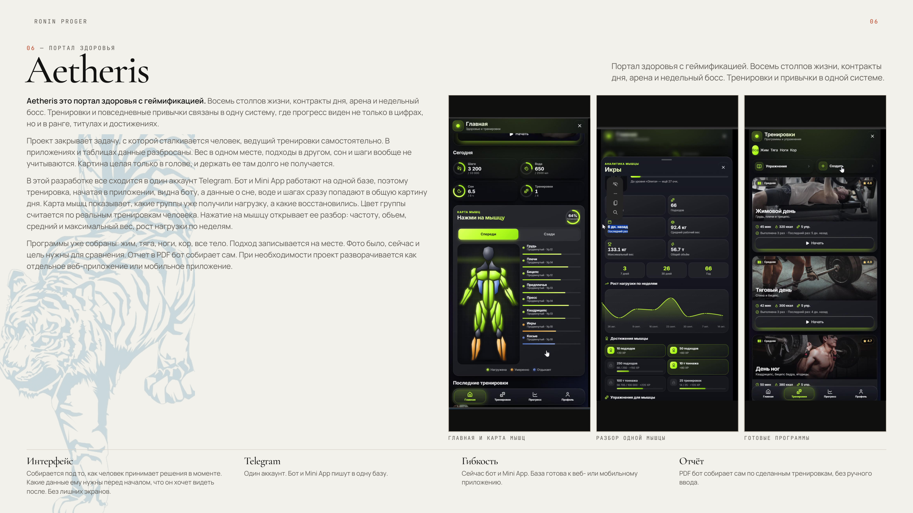
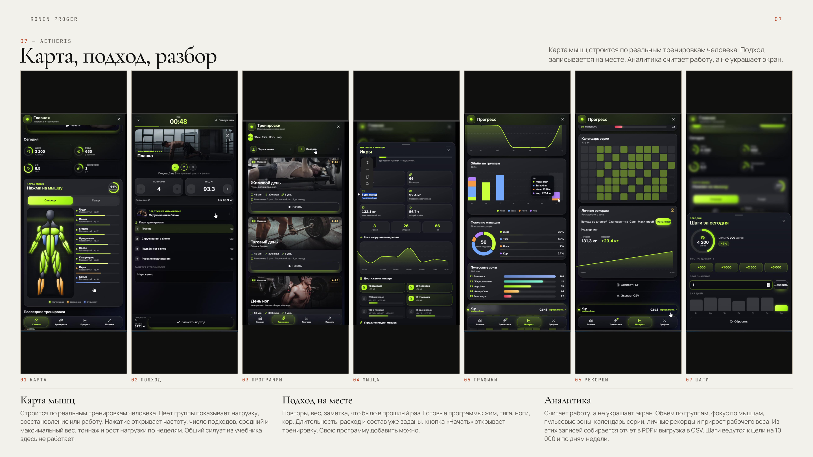
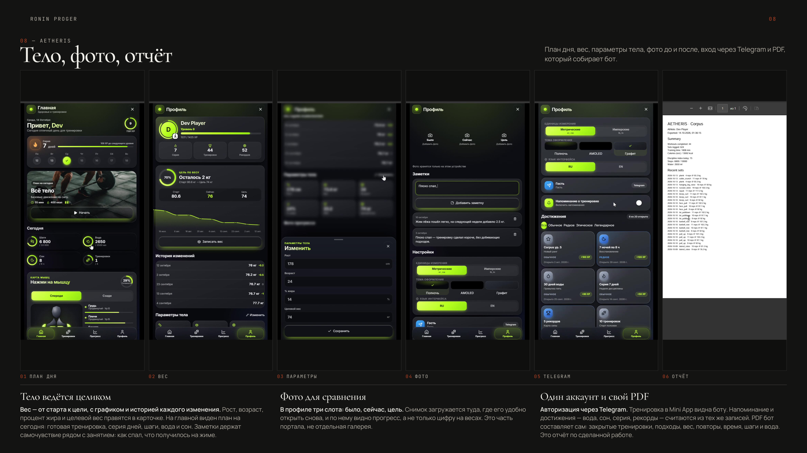

# Здоровье
Репозиторий представляет собой Mini App по трекингу тренировок и здоровья в телеграм боте. Находится в доработке.
--Приложение для тренировок и привычек. План на день, живая сессия, карта мышц и прогресс собраны в одном месте и остаются на устройстве.
Синхронизация с телеграмм аккаунтом для полноценного удобства. 

## Зачем оно нужно

Тренировка, привычки и цифры обычно живут в разных приложениях. Здесь это один контур: что делать сегодня, как проходит подход, какие мышцы уже нагружены и как меняется вес. Запись не уходит на сервер, пока свой API не подключён.

## Что умеет

- **Главная.** Серия, календарь недели, план на сегодня, шаги, вода, сон и ближайшее достижение.
- **Карта мышц.** Тело спереди и сзади: какая группа нагружена, где умеренно и что отдыхает.
- **Тренировки.** Программы по жиму, тяге, ногам и кору, библиотека упражнений и своя программа.
- **Живая сессия.** Подходы, вес, повторы, отдых и итог с опытом и рекордами.
- **Прогресс.** Неделя, месяц и год: калории, объём, фокус по мышцам, рекорды, выгрузка в PDF и CSV.
- **Профиль.** Уровень, цель по весу, параметры тела, фото прогресса, тема и напоминание о тренировке.
- **Два языка.** Русский и английский, переключение остаётся в браузере.

## Как это собрано

Клиент — одно приложение на React. Тренировки, привычки и профиль пишутся в `localStorage`. Отдельный сервер не нужен: без адреса API приложение работает само. Если адрес задан, те же данные синхронизируются с ним.

```text
браузер
    │
    ▼
React / Vite :5174
    ├── localStorage   тренировки, привычки, профиль
    └── VITE_API_URL   необязательная синхронизация
```

## Стек

| Слой | Технологии |
| --- | --- |
| Интерфейс | React 18, TypeScript, Vite |
| Движение | Framer Motion |
| Графики | Recharts |
| Экспорт | jsPDF, CSV |
| Данные | `localStorage`, опциональный API |
| Поставка | `start.bat` или `npm start` |

## Запуск

Нужен Node.js. Из папки проекта:

```bat
start.bat
```

Либо вручную:

```bash
npm install
npm start
```

Приложение открывается на `http://localhost:5174`.

По умолчанию всё локально. Адрес сервера, если он нужен, задаётся в `.env` по образцу `.env.example`.

## Как это выглядит

Портал здоровья: главная с картой мышц, разбор одной группы и готовые программы.



Карта, живой подход, программы, разбор упражнения, графики, рекорды и шаги.



План дня, вес, параметры тела, фото прогресса, вход через Telegram и PDF-отчёт.



## Структура

```text
src/health/     экраны, тренировки, привычки, прогресс
src/i18n/       русский и английский
src/styles/     визуальная система
docs/screens/   снимки для README
start.bat       установка зависимостей и запуск
```
